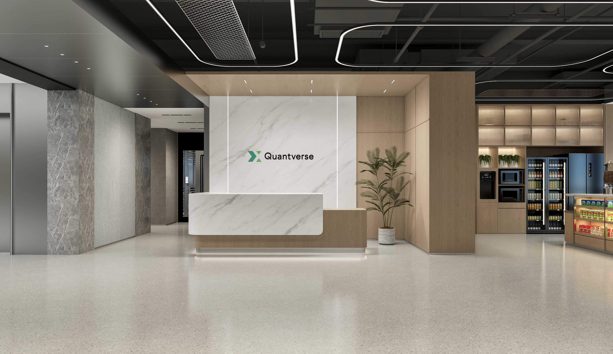
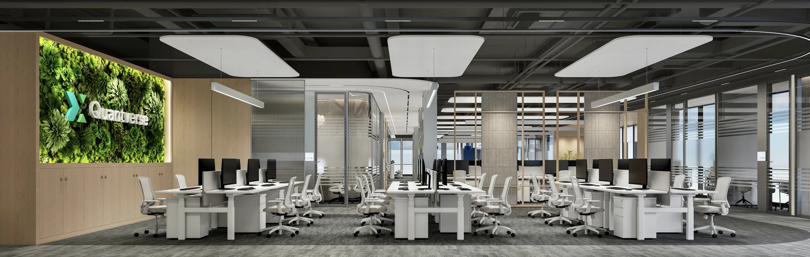

<!-- Layout revised 2026-10-29; job content checked 2026-10-28. -->

<h2>About me</h2>

哈喽哈喽，我是 <strong>Alex</strong>，现居上海，在 Quantverse 从事全球人才生态工作与面向 HR 与平台部门的 AI 工具开发（Toy Maker），负责科研与业界 AI 人才的识别与连接。工作之外，我也曾是一名半职业摄影师（作品七次收录 Vogue Italia、富士中国展、跳海 &amp; PhotoReason 双城展），家有两只可爱的小猫。欢迎一起聊聊投资、AI，或者各种好玩的事。

&nbsp; &nbsp; 

<h2>关于 Quantverse</h2>

Quantverse（上海数启寰宇人工智能科技有限公司）聚焦 AI 与金融场景的结合，运用大数据、自然语言处理、机器学习、深度学习与强化学习等技术，研发量化交易算法模型与自动化交易执行模块，并应用于量化组合管理。公司采用扁平化组织架构，以前沿技术为核心驱动力。

<ul>
<li><strong>模型研究：</strong>探索数据规律，推进前沿算法的量化应用，完成模型验证、迭代与工程化。</li>
<li><strong>AI 系统与基础设施：</strong>围绕训练框架、高性能算子、分布式通信与推理引擎，优化计算效率与系统稳定性。</li>
<li><strong>Agent 与智能工作流：</strong>开发 Agent 内核、SDK、代码执行沙箱与评测平台，让大语言模型能力进入实际业务流程。</li>
</ul>

<h2>开放岗位</h2>

点击岗位展开摘要，完整要求以 <a href="https://www.quantverse.cn/careers">官网招聘页</a> 为准。

<h3>2027 校园招聘</h3>

<strong>Research Engineer</strong> · 上海、香港

<strong>工作方向：</strong>使用深度学习、机器学习对海量数据建模，持续优化模型。探索前沿算法在量化投研场景中的应用，推动研究成果向实盘策略转化。编写可复用研究代码，搭建实验与验证流水线，优化训练与推理效率。

<strong>核心要求：</strong>毕业于国内外一流名校的计算机、数学、统计学、物理等 STEM 专业，硕士／博士，优秀本科生亦可。具备统计机器学习与深度学习基础，并在时间序列、自然语言处理、图像或数据挖掘等领域有建模经验。熟练掌握 Python，以及 PyTorch / TensorFlow 之一，具备模型改进与调优能力。

<strong>加分项：</strong>学科或机器学习竞赛成绩、相关国际顶会或期刊论文、模型工程化与分布式训练经验。

<a href="https://www.quantverse.cn/careers#campus">阅读官网完整校招要求 ↗</a>

<strong>AI 基础架构开发工程师</strong> · 上海、香港

<strong>工作方向：</strong>开发和优化模型训练框架，优化 CPU/GPU 推理延迟与算子执行效率。提升数据加载速度、缓存利用率和分布式训练中的 GPU 利用率。构建机器学习训练工具，简化从回测到实盘的部署流程。

<strong>核心要求：</strong>国内外知名院校本科及以上学历，计算机、通信、软件工程等相关专业。熟练掌握 C++ / Python / Go 中至少一种语言，具备扎实的工程实现能力。熟练掌握 TensorFlow / PyTorch，熟悉分布式训练架构与调优。在 RDMA 通信、GPU 编程、并行计算、分布式存储、高性能网络、深度学习编译器中，至少具备一项背景知识与经验。

<strong>加分项：</strong>编程竞赛成绩、分布式／异构计算、低延迟／高性能计算、模型生命周期与部署流水线、大型开源项目参与经验。

<a href="https://www.quantverse.cn/careers#campus">阅读官网完整校招要求 ↗</a>

<h3>社会招聘</h3>

<strong>Research Engineer</strong> · 上海、香港

<strong>工作方向：</strong>海量数据建模、前沿算法的量化投研应用、研究模型工程化，以及模型实验、验证与训练推理优化。

<strong>核心要求：</strong>国内外一流名校 STEM 专业硕士／博士（优秀本科生亦可）；扎实的统计机器学习与深度学习基础、相关领域建模经验；熟练掌握 Python，以及 PyTorch / TensorFlow 之一。

<strong>加分项：</strong>学科或机器学习竞赛成绩、相关国际顶会或期刊论文、模型工程化与分布式训练经验。

<a href="https://www.quantverse.cn/careers#experienced">阅读官网完整社招要求 ↗</a>

<strong>AI 系统核心开发工程师（训练/推理）</strong> · 上海、香港

<strong>工作方向：</strong>训练底层框架、超大规模训练计算／内存／通信优化；高性能核心算子及跨卡／跨节点通信；低延迟、高 QPS 场景下的推理引擎与部署工具链。

<strong>核心要求：</strong>扎实的 C/C++（C++11+）与 Python 能力；理解计算机系统与 GPU 架构，掌握 CUDA / Triton 至少其一；熟悉深度学习与 PyTorch，并具备分布式、推理引擎或训练框架优化任意一类经验。

<strong>加分项：</strong>相关竞赛成绩，深度学习编译器、NCCL、CUTLASS 等底层库经验，以及模型量化、软硬件协同、Linux 内核或分布式系统经验。

<a href="https://www.quantverse.cn/careers#experienced">阅读官网完整社招要求 ↗</a>

<strong>Agent开发工程师</strong> · 上海

<strong>工作方向：</strong>Agent 内核与产品、AI SDK / Agent SDK、代码执行沙箱、实验与评测平台，以及智能工作流和自动化工具。

<strong>核心要求：</strong>国内外一流名校计算机、人工智能、数学等 STEM 专业硕士／博士（优秀本科生亦可）；扎实的 Python 与软件工程能力、独立开发经验；熟悉大语言模型与 Agent，具备 Dify、LangGraph、Agent SDK 等平台或框架的实际开发经验。

<strong>加分项：</strong>Agent 底层框架与核心组件开发、Dify 深度二次开发／插件／企业级私有化部署、复杂 Agent 系统从 0 到 1 建设和生产落地，或相关知名开源项目的实际代码贡献。

<a href="https://www.quantverse.cn/careers#experienced">阅读官网完整社招要求 ↗</a>

<h2>工作与生活</h2>

<ul>
<li><strong>技术与办公支持：</strong>充足算力资源，支持开源与闭源模型；升降办公桌、双 4K 显示器、人体工学椅。</li>
<li><strong>健康与运动：</strong>健康体检与高端商业医疗保险；五星级酒店健身房与泳池、定期网球包场。</li>
<li><strong>日常支持：</strong>午餐与下午茶，高端户外品牌公司周边服饰。</li>
</ul>

<h2>简历投递</h2>

<strong>投递简历：</strong><a href="mailto:talent@quantverse.ltd">talent@quantverse.ltd</a>

内容整理自 <a href="https://www.quantverse.cn/">Quantverse 官网</a>，岗位核对日期：2026-10-28。招聘信息以官网最新发布为准。

